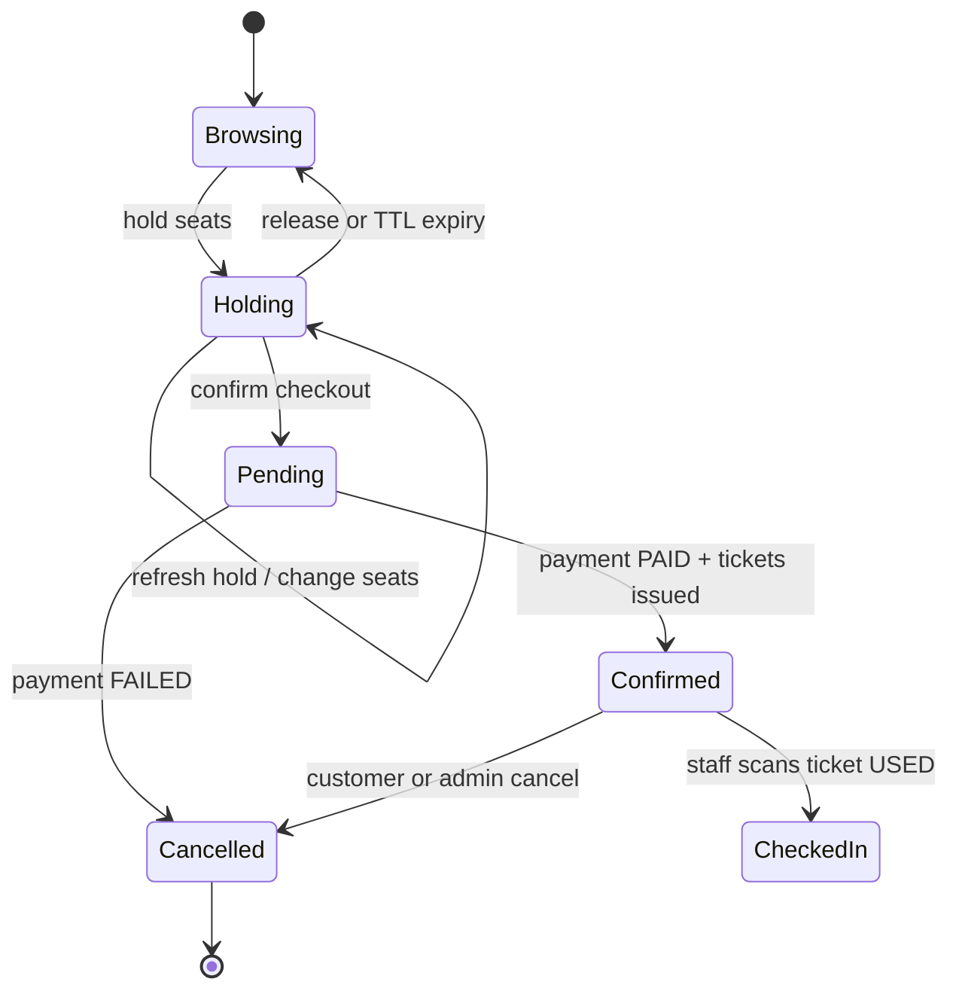
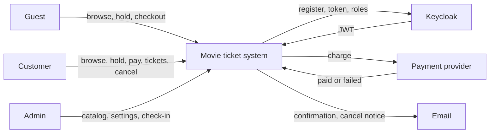
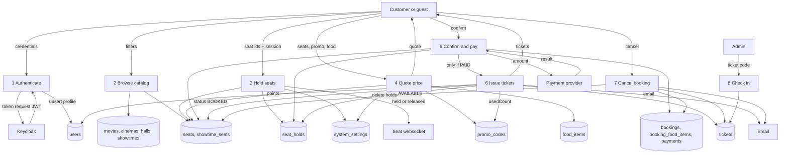
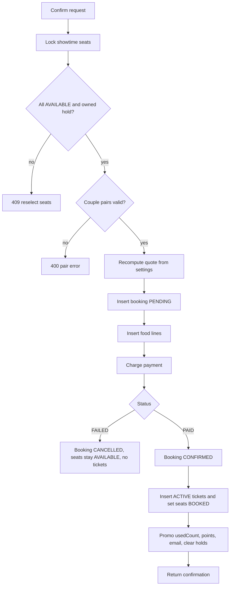

# Online Movie Ticket Booking — System Analytics

Source of truth for product behavior. Derived from `Ticket-Management-System` (`BookingService`, `SeatHoldService`, `PaymentService`, `SecurityConfig`) and the target mobile client in `movie_ticket_mobile`.

Agents implement sprints in `movie_ticket_mobile/sprints` and follow `.cursor/skills/movie-ticket-stack/SKILL.md`.

## 1. Purpose

Let a guest or registered customer discover a movie, pick a cinema showtime, reserve seats for a short window, pay, and receive a ticket that staff can check in. Admins operate catalog, pricing rules, promotions, and check-in on the existing API. The mobile app is the customer channel.

## 2. Actors

| Actor | What they do |
| --- | --- |
| Guest | Browse, hold seats, checkout without an account. Identity is name, phone, optional email on the booking. |
| Customer | Same as guest, plus account, points, booking history, and self-service cancel. |
| Staff / Admin | Catalog, halls, showtimes, promos, food, settings, reports, check-in, force-cancel. Role `ADMIN`. |
| Keycloak | Owns passwords, tokens, and realm roles. The API never verifies a local password. |
| Payment provider | Accepts the charge. Current backend is a mock that marks `PAID` in the same transaction. Target flow treats payment as a step that can fail. |

## 3. Functionality

### 3.1 Identity

- Register, login, refresh, logout via Keycloak (`/api/auth/**`).
- Access token is a JWT. API is a stateless resource server (`Authorization: Bearer`).
- First authenticated call syncs the Keycloak user into `users` (email unique). `password` is the placeholder `managed-by-keycloak`.
- Roles: `CUSTOMER` (default), `ADMIN`.
- Account status: `ACTIVE`, `SUSPENDED`, `BANNED`. Suspended or banned users must not checkout.
- Profile: read and update name/phone; password change goes to Keycloak.

### 3.2 Catalog (public)

- Home and movie list. Filter by status: `NOW_SHOWING`, `COMING_SOON`, `ARCHIVED`.
- Movie detail: title, description, genre, director, language, format, cast, trailer, rating, release date, duration, poster, banner.
- Cinema: name, address, hours, coordinates. Hall belongs to a cinema and has city, type, capacity, Dolby Atmos, ScreenX, amenities.
- Seat template (`seats`) is per hall: `seatCode` unique in the hall, `seatType` `NORMAL` or `COUPLE`, `rowNumber`.
- Showtime links one movie and one hall, with `showDate`, `showTime`, `normalPrice`, `couplePrice`, and `blocked`.
- Search showtimes and list movies that still have bookable shows (`/api/showtimes/**`).
- Coming-soon reminder: store email + movie (`movie_reminders`).

### 3.3 Seat inventory (two layers)

Do not collapse these into one status.

| Layer | Store | Meaning |
| --- | --- | --- |
| Sold | `showtime_seats.status` | `AVAILABLE` or `BOOKED`. Only checkout confirmation sets `BOOKED`. Cancel sets `AVAILABLE`. |
| Temporary hold | `seat_holds` | Session owns `showtime_seat_id` until `expiresAt`. A hold does not change seat status. |

Hold rules (`SeatHoldService`):

- Caller sends showtime seat ids and a `sessionId`.
- Seat cap: the seats this session already holds on the showtime plus the new ones must not exceed `max_seats_per_booking` (default 8). Every seat counts once, so a couple pair counts as two. Above the cap → 400 `SEAT_LIMIT`. Quote, confirm, and PayWay start apply the same cap to the selected seats.
- Lock those rows (`FOR UPDATE`). Reject if any seat is not `AVAILABLE`.
- Reject if another session has a non-expired hold on any of those ids.
- Replace this session's holds on the same ids. Expiry = now + hold minutes from `system_settings` for a session's first hold on the showtime. While the session still holds seats there, a new hold (changed or same seats) keeps that running expiry and its extended flag: one clock per session and showtime, so re-holding never resets the timer. Releasing every seat and holding again starts a new clock.
- Extend (`POST /api/seat-holds/extend`): once per hold, adds `hold_extend_minutes` (default 5) to every hold the session has on the showtime, under the seat row lock, and publishes `HELD` with the new expiry. No active hold → 409 `HOLD_EXPIRED`; already extended → 409 `HOLD_EXTEND_LIMIT`.
- Publish the hold on the seat websocket so other clients gray those seats out.
- A scheduler deletes expired holds and publishes the release.
- Checkout may proceed only when this session still owns an active hold for every selected seat, or the confirm transaction re-validates availability under the same row lock. Another user's hold is a conflict.

### 3.4 Checkout pricing

Implemented in `BookingService.resolveCheckoutData`. At least one seat is required. Every seat must belong to the showtime and be `AVAILABLE`.

Couple seats:

- `seatCode` matches `^([A-Za-z]+)(\d+)$`.
- Count of couple seats must be even.
- Within a row, sort numbers and pair them: each pair is `(odd, odd+1)` such as `A1+A2`, `A3+A4`. A lone seat or a pair that starts on an even number is rejected.
- Couple price is charged **per pair**, not per seat: `couplePrice * (coupleCount / 2)`.
- Normal seats: `normalPrice * normalCount`.

Price stack (rates come from `system_settings`, with these defaults):

```
base            = normalPrice * normalCount + couplePrice * (coupleCount / 2)
morningDiscount = showTime < 12:00 ? base * 0.10 : 0
effectiveBase   = base - morningDiscount
weekendSurcharge= Sat or Sun ? effectiveBase * 0.10 : 0
subtotal        = effectiveBase + weekendSurcharge
promoDiscount   = valid promo ? subtotal * percent / 100 : 0
tax             = subtotal * 0.10
serviceFee      = 1.50
foodTotal       = sum(unitPrice * qty) for available items
total           = subtotal - promoDiscount + tax + serviceFee + foodTotal
```

Promo applies to **subtotal only** (not tax, service fee, or food). Percent is 1–100. Code must be active, inside `validUntil` when set, under `maxUses` (`0` = unlimited), and `subtotal >= minPurchase` when set.

Food lines snapshot `unitPrice` at purchase time on `booking_food_items`.

Quote (`buildCheckout`) does not lock seats. Confirm (`confirmCheckout`) does.

### 3.5 Confirm booking (target transaction)

One database transaction. Order matters so a failure cannot leave a paid booking without tickets, or tickets without payment.

1. Re-lock selected `showtime_seats`. Re-run availability, couple-pair, and hold-ownership checks.
2. Recompute the quote on the server. Ignore any total sent by the client.
3. Insert `bookings` as `PENDING` with user **or** guest name/phone/email, showtime, fee, tax, discount, promo code, payment method, `bookedAt`.
4. Insert `booking_food_items`.
5. Call payment.
   - `PAID`: set booking `CONFIRMED`, then issue tickets, then record promo usage, then add loyalty points, then send email, then delete this session's holds.
   - `FAILED` or timeout: set booking `CANCELLED` (or delete the pending row), leave seats `AVAILABLE`, do not issue tickets, do not increment `usedCount`, do not add points.
6. Tickets: one row per seat, unique `ticketCode`, status `ACTIVE`, `issuedAt` now. Mark each `showtime_seat` `BOOKED`.

Current backend shortcut: `processMockPayment` always returns `PAID` and flips the booking to `CONFIRMED` before tickets are issued, and promo usage is recorded before payment. New work must move promo usage, points, and email to after `PAID`, and must leave a failed payment with no tickets and no booked seats. Keep the mock provider behind `PaymentService` so a real gateway replaces one class.

Loyalty: registered user only, `points += totalAmount` truncated to an integer (current rule). Guests earn nothing.

### 3.6 After purchase

- My bookings: authenticated, newest first.
- Every booking has a `reference`: 8 characters from `23456789ABCDEFGHJKLMNPQRSTUVWXYZ` (no `0/O/1/I`), unique, set on insert. It is on the success screen, the booking, the QR screen, and the emails.
- Guest lookup (`POST /bookings/lookup { reference, phone }`): the booking whose reference matches and whose phone (guest phone, else the account phone) has the same digits, ignoring a `855` country code and the trunk `0`. Any miss is 404 `BOOKING_NOT_FOUND`. Five misses from one client in 10 minutes → every lookup from it is 429 `TOO_MANY_ATTEMPTS` until the oldest miss is 10 minutes old. Hits do not count.
- A PayWay payment may be polled or closed by the signed-in owner or by the session that started it. The app keeps that session across a kill during the ABA hand-off (pending payment, under 30 minutes) so it can still finish the payment.
- Confirmation payload includes showtime, movie, hall, seats, amounts, tickets.
- Ticket QR (`/tickets/{ticketCode}/qr`) and PDF (`/tickets/{ticketCode}/pdf`).
- Customer cancel (`/bookings/cancel/{id}`):
  - Caller must be the booking's user. Guests cannot use this endpoint.
  - Reject if already `CANCELLED`.
  - Reject when now is inside the cancellation window (default 2 hours before show start; key `cancellation` hours in settings).
  - Set each ticket `CANCELLED`, set its showtime seat `AVAILABLE`, set booking `CANCELLED`, email the notice.
  - If the booking was `CONFIRMED`, give back what the paid path gave it, in the same transaction: subtract `floor(totalAmount)` points from the user (never below 0) and decrement the promo's `usedCount` (never below 0). A `PENDING` booking earned nothing, so nothing is reversed.
  - If its payment is `PAID`, set the payment `REFUND_PENDING`. An admin returns the money by hand and sets `REFUNDED` (`POST /admin/bookings/{id}/refund`). No provider refund call in v1.
- Admin cancel skips the time window and reverses the same way.
- Reading one booking (`/bookings/confirmation/{id}`) is owner only: the signed-in user it belongs to, or the `X-Session-Id` that created it (`bookings.session_id`). Anyone else, and a missing id, get 404 `BOOKING_NOT_FOUND`.
- Check-in (`/admin/checkin`): staff scans `ticketCode`. `ACTIVE` becomes `USED` and `scannedAt` is set. `USED` and `CANCELLED` are rejected.

### 3.7 Admin (existing API, not the customer app)

Movies, cinemas, halls, showtimes (create, block, copy next week), food items and images, food orders, promo codes, notifications (`ALL` or `MOVIE`), users (status, points), settings, dashboard, booking export, check-in. All under `/admin/**` with `ROLE_ADMIN`.

### 3.8 Settings that change money and time

| Key intent | Default | Used by |
| --- | --- | --- |
| Service fee | 1.50 | Checkout |
| Tax rate | 0.10 | Checkout |
| Weekend surcharge rate | 0.10 | Sat/Sun shows |
| Morning discount rate | 0.10 | Show time before noon |
| Hold minutes | service setting | Seat hold TTL |
| Cancellation hours | 2 | Customer cancel |
| Hold extend minutes | 5 | One extend per hold |
| Max seats per booking | 8 | Hold, quote, confirm, PayWay start (`SEAT_LIMIT`) |

Read these on the server at quote time. Do not hard-code them in Flutter.

## 4. Booking state



Seat status stays `AVAILABLE` through `Holding`. It becomes `BOOKED` only on `Confirmed`.

## 5. Entity relationship diagram

Every business table except `system_settings` extends audit columns: `created_at`, `updated_at`, `created_by`, `updated_by`.

```mermaid
erDiagram
    USERS ||--o{ BOOKINGS : places
    USERS {
        bigint id PK
        string name
        string email UK
        string phone
        string password
        string role "ADMIN | CUSTOMER"
        int points
        string status "ACTIVE | SUSPENDED | BANNED"
    }

    CINEMAS ||--o{ HALLS : contains
    CINEMAS {
        uuid id PK
        string name
        string address
        string openingHours
        int totalHalls
        float latitude
        float longitude
    }

    HALLS ||--o{ SEATS : layouts
    HALLS ||--o{ SHOWTIMES : hosts
    HALLS {
        bigint id PK
        uuid cinema_id FK
        string name UK
        int totalSeats
        string city
        string address
        string type
        int capacity
        bool hasDolbyAtmos
        bool hasScreenX
        string amenities
    }

    MOVIES ||--o{ SHOWTIMES : screens
    MOVIES ||--o{ MOVIE_REMINDERS : reminds
    MOVIES {
        bigint id PK
        string title
        string genre
        string director
        string language
        string format
        string movie_cast
        string trailerUrl
        string rating
        date releaseDate
        int durationMinutes
        string status "NOW_SHOWING | COMING_SOON | ARCHIVED"
        string imagePath
        string bannerPath
    }

    SHOWTIMES ||--o{ SHOWTIME_SEATS : inventory
    SHOWTIMES ||--o{ BOOKINGS : sold_as
    SHOWTIMES {
        bigint id PK
        bigint movie_id FK
        bigint hall_id FK
        date showDate
        time showTime
        decimal normalPrice
        decimal couplePrice
        bool blocked
    }

    SEATS ||--o{ SHOWTIME_SEATS : instance
    SEATS ||--o{ TICKETS : printed_on
    SEATS {
        bigint id PK
        bigint hall_id FK
        string seatCode
        string seatType "NORMAL | COUPLE"
        int rowNumber
    }

    SHOWTIME_SEATS ||--o{ SEAT_HOLDS : "held by seat id"
    SHOWTIME_SEATS {
        bigint id PK
        bigint showtime_id FK
        bigint seat_id FK
        string status "AVAILABLE | BOOKED"
    }

    SEAT_HOLDS {
        bigint id PK
        bigint showtimeSeatId
        string sessionId
        datetime expiresAt
        bool extended "the one extend was used"
    }

    BOOKINGS ||--o| PAYMENTS : paid_by
    BOOKINGS ||--o{ TICKETS : issues
    BOOKINGS ||--o{ BOOKING_FOOD_ITEMS : includes
    BOOKINGS {
        bigint id PK
        bigint user_id FK "nullable"
        string guestName
        string guestPhone
        string guestEmail
        bigint showtime_id FK
        decimal totalAmount
        decimal serviceFee
        decimal taxAmount
        decimal discountAmount
        string promoCode
        string paymentMethod
        string status "PENDING | CONFIRMED | CANCELLED"
        datetime bookedAt
        string sessionId "creating X-Session-Id; reader check"
        string reference UK "8 chars, typed back in for lookup"
    }

    PAYMENTS {
        bigint id PK
        bigint booking_id FK UK
        decimal amount
        string method
        string status "PENDING | PAID | FAILED | REFUND_PENDING | REFUNDED"
        datetime paidAt
    }

    TICKETS {
        bigint id PK
        bigint booking_id FK
        bigint seat_id FK
        string ticketCode UK
        string status "ACTIVE | USED | CANCELLED"
        datetime issuedAt
        datetime scannedAt
    }

    FOOD_ITEMS ||--o{ BOOKING_FOOD_ITEMS : ordered
    FOOD_ITEMS {
        bigint id PK
        string name
        string description
        decimal price
        string imageUrl
        bool available
        int stockQuantity
    }

    BOOKING_FOOD_ITEMS {
        bigint id PK
        bigint booking_id FK
        bigint food_item_id FK
        int quantity
        decimal unitPrice
    }

    PROMO_CODES {
        bigint id PK
        string code UK
        string discountType "PERCENT | FIXED"
        int discountPercent
        decimal minPurchase
        date validUntil
        int maxUses
        int usedCount
        bool active
    }

    MOVIE_REMINDERS {
        bigint id PK
        bigint movie_id FK
        string email
    }

    NOTIFICATIONS {
        bigint id PK
        string title
        string message
        string targetType
        string targetRef
        datetime sentAt
        int sentCount
    }

    SYSTEM_SETTINGS {
        string setting_key PK
        string setting_value
        string description
    }
```

`seat_holds.showtimeSeatId` is a logical reference to `showtime_seats.id` (stored as a column, not a JPA association). `bookings.promoCode` stores the code string, not a foreign key. Checkout still validates that string against `promo_codes`.

## 6. Data flow diagrams

### 6.1 Context (level 0)



### 6.2 Level 1 — customer booking



### 6.3 Level 2 — confirm and pay (process 5 and 6)



## 7. API map the mobile client uses

| Flow | Method and path | Auth |
| --- | --- | --- |
| Login / register / refresh / logout | `POST /api/auth/login`, `/register`, `/refresh`, `/logout` | Public |
| Movies | `GET /api/movies`, `GET /movies/{id}` | Public |
| Showtimes | `GET /api/showtimes/search`, `/available-movies` | Public |
| Seat map | `GET /bookings/seats/{showtimeId}` | Public |
| Hold / release / state / extend | `POST /api/seat-holds/hold`, `/release`, `/extend`, `GET /state` | Public + session id |
| Quote | `GET /bookings/checkout/{showtimeId}` | Public |
| Validate promo | `POST /bookings/promo/validate` | Public |
| Confirm | `POST /bookings/checkout/{showtimeId}` | Public; user attached when bearer present |
| Confirmation | `GET /bookings/confirmation/{bookingId}` | Owner: bearer user or creating `X-Session-Id`; else 404 `BOOKING_NOT_FOUND` |
| Guest lookup | `POST /bookings/lookup` | Public; 404 `BOOKING_NOT_FOUND`, 429 `TOO_MANY_ATTEMPTS` |
| My bookings / cancel / profile | `GET /bookings/my-bookings`, `POST /bookings/cancel/{id}`, `/profile` | Bearer |
| Tickets | `GET /tickets`, `GET /tickets/{code}`, `/qr`, `/pdf` | As currently permitted by security config |
| Reminder | `POST /api/reminders` | Public |

Admin routes stay on `/admin/**`. The customer app does not call them.

## 8. Invariants an agent must not break

1. Client-supplied totals are display-only. The server recomputes price inside the confirm transaction.
2. A seat is `BOOKED` only after payment `PAID` and ticket insert succeed together.
3. Holds expire and never overwrite `BOOKED`.
4. Couple seats sell only as odd-even pairs in the same row, priced per pair.
5. Promo discount never includes tax, service fee, or food.
6. Keycloak stores credentials. The `users.password` column is not a login secret.
7. Customer cancel checks owner and the cancellation window. Admin cancel does not use that window.
8. Two confirms for the same seat must serialize on the row lock. The loser gets "already booked", not a second ticket.
9. A booking is read only by its owner: the signed-in user it belongs to, or the session that created it. Everyone else gets the same 404 as a missing id, so ids cannot be probed for names, phones, or ticket codes.
10. One session never holds or books more than `max_seats_per_booking` seats on a showtime; a couple pair counts as two.
